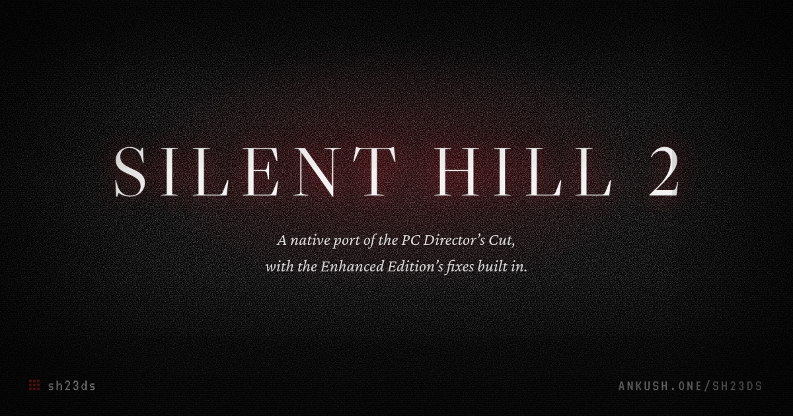
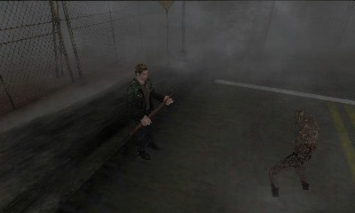
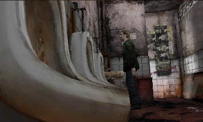
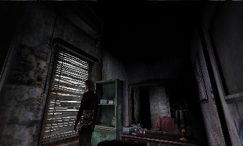

<p align="center">
  
</p>

<h1 align="center">sh23ds: Silent Hill 2 for Nintendo 3DS</h1>

<p align="center">
  A native port of the PC Director's Cut for the New 3DS and the original 3DS.<br>
  Bring your own copy of the game.
</p>

<p align="center">
  <a href="https://github.com/ankushKun/sh23ds/releases/latest"></a>
  
  <a href="LICENSE"></a>
</p>

<p align="center">
  <a href="https://ankush.one/sh23ds/"><b>Website</b></a> ·
  <a href="#install">Install</a> ·
  <a href="https://ankush.one/sh23ds/packer.html">Packer</a> ·
  <a href="https://github.com/ankushKun/sh23ds/releases/latest">Download</a> ·
  <a href="port/STATUS.md">Status</a> ·
  <a href="#contributing">Contributing</a>
</p>

<br>

sh23ds is a new engine, written in C for the 3DS, that plays Silent Hill 2 from the PC version's own data. The game logic, camera, lighting and events are rebuilt from the PC executable and run as native code, so nothing is emulated. The [Enhanced Edition](https://enhanced.townofsilenthill.com/SH2/)'s fixes are built in.

**sh23ds contains no game data.** You need your own copy of the PC game, which the packer converts on your computer.

> [!NOTE]
> This is a development build. The whole game plays from the prologue to every ending, including Born From a Wish, but expect rough edges and please [report](https://github.com/ankushKun/sh23ds/issues) what you find.

<p align="center">
  
  
  
</p>

## Install

You need:

- a New 3DS, New 2DS XL, or any original 3DS or 2DS, running [Luma3DS](https://3ds.hacks.guide/)
- the PC release of *Silent Hill 2: Director's Cut* (the packer checks for the retail `sh2pc.exe`)
- about 1.3 GB free on the SD card

Then:

1. Convert your game: open the [packer page](https://ankush.one/sh23ds/packer.html) in a desktop browser, choose your `Silent Hill 2` folder and save the zip. Nothing is uploaded. If you'd rather use Docker:
   ```sh
   docker run --rm -v "/path/to/Silent Hill 2:/game:ro" -v "$PWD/sd:/out" ghcr.io/ankushkun/sh23ds-packer
   ```
   Either way you get a `3ds` folder. [More packer options](tools/packer/README.md).
2. Copy the `3ds` folder to the root of the SD card. The game data ends up in `sdmc:/3ds/sh23ds/`.
3. Dump the DSP firmware once with [DSP1](https://github.com/zoogie/DSP1/releases), or the game has no sound.
4. Install `sh23ds.cia` from the [latest release](https://github.com/ankushKun/sh23ds/releases/latest) with FBI, or scan the QR code on the [website](https://ankush.one/sh23ds/#install) with FBI's *Remote Install*.

<details>
<summary>What the SD card looks like afterwards</summary>

```text
sdmc:/3ds/
├── dspfirm.cdc     from DSP1
├── sh23ds.3dsx     only if you use the Homebrew Launcher instead of the CIA
└── sh23ds/         the game data from the packer
```

The CIA is the better choice on a New 3DS: it asks for the 804 MHz clock and the 124 MB memory mode, which a `.3dsx` only gets if the Homebrew Launcher was started with them.

</details>

If sh23ds starts and can't find its data, it says so: whether the folder is missing, in the wrong place or only half copied, with the steps and a QR code of the [install guide](https://ankush.one/sh23ds/install.html).

## Features

- The whole game: every area, puzzle, enemy, boss and ending, New Game+ and Born From a Wish
- The PC camera, room lighting, fog and flashlight, ported from the executable
- All 128 in-engine cutscenes, and the movies re-encoded for the console
- The PC's music, sound effects and voices, mixed the same way
- The [Enhanced Edition fixes](port/EE_FIXES.md), such as the PS2 flashlight and the corrected fog and lighting
- Stereoscopic 3D on the top screen with the 3D slider
- Made for the New 3DS's faster CPU and extra memory, with a lighter 30 fps profile for the original 3DS ([details](port/OLD3DS.md))

## Controls

| | New 3DS | Original 3DS |
| --- | --- | --- |
| Walk and turn | Circle Pad or D-Pad | Circle Pad, or D-Pad left and right |
| Check, open, attack | A | A |
| Run (hold) | B | B |
| Aim (hold) | R | R |
| Look around (hold) | ZL | L |
| Next weapon | L | D-Pad up |
| Quick turn | ZR | D-Pad down |
| Flashlight / items | X / Y | X / Y |
| Map | touch screen | touch screen |
| Pause | START | START |

Every action can be rebound in *Control Options*. The full layouts are in [CONTROLS.md](port/CONTROLS.md).

## Building from source

The toolchains run in Docker, so that is all you need.

```sh
git clone https://github.com/ankushKun/sh23ds.git && cd sh23ds
./port/build.sh      # port/sh23ds.3dsx
./port/package.sh    # port/sh23ds.cia
```

## Contributing

The port is built by reading the PC executable in Ghidra and translating its functions to C, with the original address in a comment. Start with [AGENTS.md](AGENTS.md): it covers the setup, where everything is, and how to port and review against the original.

| Doc | What's in it |
| --- | --- |
| [STATUS.md](port/STATUS.md) | What works and what's left, heaviest first |
| [DEBUGGING.md](port/DEBUGGING.md), [TESTING.md](port/TESTING.md) | The debug file, emulator runs and the test suites |
| [RESEARCH.md](docs/RESEARCH.md) | How the executable was mapped, and key addresses |

> [!CAUTION]
> Never commit anything that comes from the game: exe bytes, assets, converted data, Ghidra databases or decompiler output. `tools/install_hooks.sh` adds a pre-commit check.

Bug reports are welcome in [Issues](https://github.com/ankushKun/sh23ds/issues). Please include your console model, your Luma3DS version and what you were doing.

## FAQ

<details>
<summary><b>Where do I get the game files?</b></summary>
<br>
From your own copy of the PC game. This project doesn't host, link to or share game files, and issues asking for them will be closed.
</details>

<details>
<summary><b>Does it run on an original 3DS or 2DS?</b></summary>
<br>
Yes. The game detects the console and switches to a lighter profile: fewer fog sprites and streamed town tiles, no character shadows and a 30 fps cap. It fits in the normal 64 MB of memory. <a href="port/OLD3DS.md">OLD3DS.md</a> has the details, including what has been tested so far.
</details>

<details>
<summary><b>Can I use the v1.0 PC release, or the Enhanced Edition?</b></summary>
<br>
Not v1.0: the converters read tables from the Director's Cut exe, so the packer only accepts that build. The Enhanced Edition's packs work, and the packer uses them when it finds your <code>sh2e</code> folder. Put the original Director's Cut exe back first, since the Enhanced Executable replaces it.
</details>

<details>
<summary><b>Is this the 2024 remake, or an emulator?</b></summary>
<br>
It's neither. This is the 2001 game, rebuilt from the PC Director's Cut and running as native code on the 3DS's own CPU and GPU. The PC game's data is converted once, on your computer.
</details>

## Credits

- [Silent Hill 2: Enhanced Edition](https://github.com/elishacloud/Silent-Hill-2-Enhancements) by Elisha Riedlinger and contributors, whose fixes and research into the PC executable this port builds on
- The Silent Hill Database for its file format notes, and the PS2 beta's debug information, which names much of the PC code
- [devkitPro](https://devkitpro.org/), libctru and citro3d
- [pl_mpeg](https://github.com/phoboslab/pl_mpeg) by Dominic Szablewski, which plays the movies
- [pycgfx](https://github.com/skyfloogle/pycgfx) by skyfloogle and the notes in [CBC for YANBF](https://github.com/daaaaavia/CBC-for-YANBF), for the 3D HOME Menu banner
- [Ghidra](https://ghidra-sre.org/) and [Azahar](https://azahar-emu.org/)
- [Libre Caslon Display](https://github.com/impallari/Libre-Caslon-Display), [Crimson Pro](https://github.com/Fonthausen/CrimsonPro) and [VT323](https://fonts.google.com/specimen/VT323) (SIL Open Font License), on the website and the setup screen

## License

sh23ds is released under the [GNU General Public License v3.0](LICENSE). Bundled third-party code keeps its own license.

This is a fan project, not affiliated with or endorsed by Konami or Nintendo. *Silent Hill* is a trademark of Konami Digital Entertainment and Nintendo 3DS is a trademark of Nintendo. Playing requires a legally obtained copy of the PC game.

<br>

<p align="center">
  Made by <a href="https://ankush.one">ankushKun</a> · <a href="https://github.com/ankushKun">GitHub</a> · <a href="https://x.com/ankushKun_">X</a>
</p>
